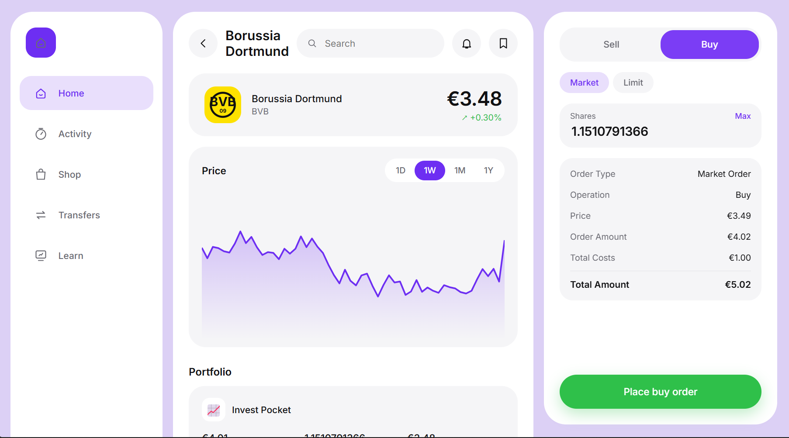

# Invest Pocket

An open-source React dashboard for browsing an investment and placing a simulated buy or sell order.

Invest Pocket is a front-end design prototype, not a brokerage or financial service. It does not execute real trades and does not connect to a backend.

## Preview



## Features

- Responsive, collapsible sidebar
- Light, dark, and system theme support
- Interactive stock chart with time ranges
- Market and limit order simulations
- Buy/sell validation and simulated order confirmation
- Price alert, watchlist, and analyst-note controls
- Accessible keyboard and focus interactions

## Design language

The interface uses a calm, compact product aesthetic that can be adapted to other applications:

- **Surfaces:** Large rounded panels over a soft lavender canvas
- **Hierarchy:** High-contrast typography, 16 px or smaller labels, and restrained secondary text
- **Color:** One purple brand accent, green for positive actions, red for errors, and neutral card surfaces
- **Spacing:** Repeated 14–24 px gaps and 24–34 px corner radii
- **Motion:** Short 120–350 ms transitions, subtle press feedback, and reduced layout movement
- **States:** Explicit hover, active, selected, success, validation, and disabled states
- **Accessibility:** Visible keyboard focus, semantic buttons, labelled inputs, and theme-aware contrast

Design tokens are defined as CSS variables in `src/index.css`, making it straightforward to create a new theme without changing the React components.

## Run locally

Requires Node.js 18 or later.

```bash
npm install
npm run dev
```

Open the local URL shown by Vite, normally `http://localhost:5173`.

## Commands

```bash
npm run dev      # Start the development server
npm run build    # Create a production build in dist/
npm run preview  # Preview the production build
```

## Project structure

```text
src/
├── App.jsx       # UI, state, interactions, and chart generation
├── index.css     # Design tokens and complete visual system
└── main.jsx      # React entry point
```

## Contributing

Contributions are welcome. You may:

- Fix bugs or accessibility issues
- Improve responsive behavior
- Add documentation or design examples
- Reuse components and themes in your own project
- Suggest improvements through issues or pull requests

Before submitting a pull request, run `npm run build` and verify the change in both light and dark themes.

Please keep contributions focused and preserve the existing design language unless the pull request intentionally changes it.

## License

This project is free and open source under the [MIT License](LICENSE). You may use, copy, modify, merge, publish, distribute, sublicense, and sell copies of the software, including in commercial products.
